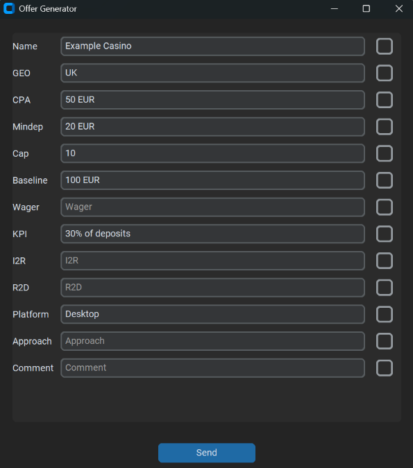
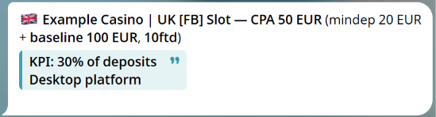

# Offer Generator

A small desktop form I use at work. Advertisers send offer conditions in all kinds of formats; I type the values I need into the form and get a ready-to-send offer message in Telegram.

I use it for every new offer I post, so the point was speed: type the fields, press Enter, done.

## Why Telegram

The message has to contain a Telegram-style quote block (`<blockquote>`). Telegram renders it only inside its own messages, not in plain HTML, so the app sends the text to me through a bot and I forward it from there.

## Example

Fields filled in (made-up data):



Message that arrives in Telegram:



The text in the brackets changes with the conditions: for example, if mindep and baseline are equal it becomes `mindep = baseline 100 EUR`.

## Features

- Several names separated by commas produce several lines in one message
- A flag emoji is built automatically from the GEO code
- "Lock" checkbox next to each field keeps its value after sending (handy for fields that repeat between offers)
- Keyboard-only workflow: Up/Down move between fields, Enter goes to the next unlocked field and sends the form after the last one
- The offer name is copied to the clipboard on send

## Running it

```bash
pip install -r requirements.txt
cp .env.example .env      # add your bot token and your Telegram user ID
python offer_generator.py
```

To build a Windows `.exe`:

```bash
pip install pyinstaller
pyinstaller --onefile --noconsole offer_generator.py
```

Put the `.env` file next to the `.exe`.

## Notes

- I built this around my own daily work. I used AI as a coding assistant, mostly for the window layer (customtkinter), and I maintain and extend the script myself.
- The message format (`[FB]`, "Slot" as the default approach, field names) matches my own workflow and is easy to change at the top of `offer_generator.py`.
- Messages are in English; the original version of the UI was in Russian.

## License

MIT, see [LICENSE](LICENSE).
